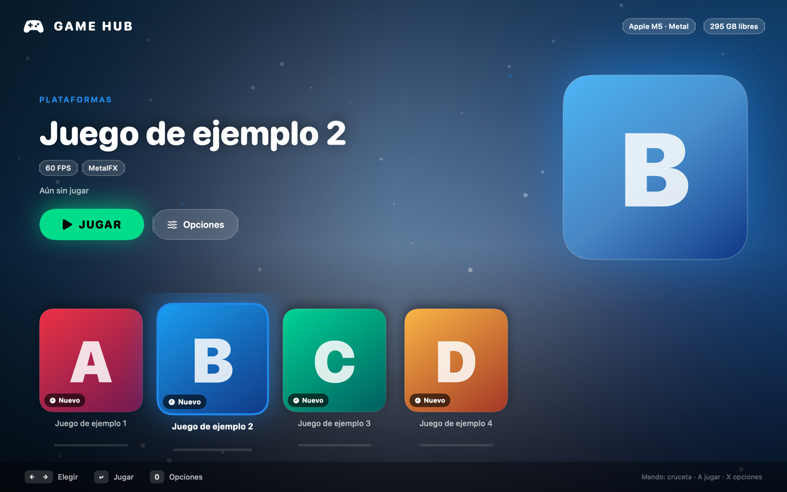

# Game Hub

A small, fast game launcher for macOS (SwiftUI, Apple Silicon) for people who run native Mac builds of games, such as the `.app` bundles produced by [nxnative](https://github.com/seedds/nxnative) or [MacNativeGames](https://github.com/ly05010419/macnativegames). Cover-art shelf, looping video backdrop on hover, mouse parallax, play-time per game, controller navigation.



*The screenshot uses placeholder art. Game Hub ships **no games and no artwork**: you add your own apps and images.*

## Features

- Shelf of games with a big hero view, parallax and a cursor-following light (the UI uses 9 % of one core with the mouse moving).
- Optional short looping clip behind the hero (`mkclip` turns a PNG sequence into a seamless H.264 loop).
- Play time and last session per game. Apps that write a `playtime.log` (`<epoch start> <seconds>` per line) are read directly; otherwise the hub times the session itself.
- Play / Close button, detects a running game, refuses to start a second one (they share GPU and audio).
- Per-game options passed as environment variables when launching: `DM_FULLSCREEN`, `DM_UPSCALE`, `DM_HUD`, `DM_FRAMEGEN` (nxnative host options; entries with `"tweakable": true`).
- Keyboard (arrows, Return, `O`) and game-controller navigation (D-pad, A, X, B).
- While a game runs (or the window is hidden) the hub stops animating so it takes no GPU or CPU from the game.

## Build and install

Requires macOS 14+ and the Swift toolchain (Xcode or Command Line Tools).

```sh
./build.sh                 # installs ~/Applications/Game Hub.app
./build.sh /Applications   # or choose the folder
```

## Library

The hub reads `~/Library/Application Support/GameHub/library.json` (override the folder with the `GAMEHUB_ROOT` environment variable). Settings are saved next to it in `settings.json`. Copy [`examples/library.example.json`](examples/library.example.json) and the `examples/art` folder as a starting point.

| field | meaning |
|---|---|
| `id`, `name`, `subtitle`, `tags` | identity and labels |
| `app` | path to the `.app` to open |
| `bundle` | its bundle identifier (used to detect that it is running) |
| `art` | cover image (any size; decoded once as a 720 px thumbnail) |
| `accent` | `#RRGGBB` colour for highlights |
| `tweakable` | `true` if the app is an nxnative launcher that honours the `DM_*` variables |
| `note` | text shown in Options for non-tweakable games |
| `clip` | optional looping `.mp4` for the backdrop |
| `playlog` | optional path of the game's `playtime.log` |

Relative paths and `~` are resolved from the library folder.

To make a clip: `swiftc -O tools/mkclip.swift -o mkclip && ./mkclip <folder with f_0.png f_1.png ...> out.mp4 [fps]`.

## Notes

- Tested only on an Apple M5 MacBook Air with nxnative apps and a MacNativeGames app. Reports from other Macs are welcome.
- The interface is in Spanish for now; translation PRs are welcome.
- Game Hub is not affiliated with or endorsed by any game publisher. Use it only with games you own.
- SF Symbols are used inside the running UI only; the app icon (`tools/mkicon.swift`) is drawn from scratch.

## License

MIT, see [LICENSE](LICENSE).

---

# Game Hub (español)

Lanzador para macOS de juegos nativos en Mac (por ejemplo las `.app` que genera nxnative o MacNativeGames): estantería de portadas, clip en bucle al pasar el cursor, paralaje con el mouse, tiempo jugado por juego y navegación con mando.

- **Instalar:** `./build.sh` (instala en `~/Applications`) o `./build.sh /Applications`. Necesita macOS 14+ y las herramientas de Swift.
- **Biblioteca:** `~/Library/Application Support/GameHub/library.json` (o la carpeta de `GAMEHUB_ROOT`). Parte de `examples/library.example.json`; las rutas relativas se leen desde esa carpeta.
- **No incluye juegos ni portadas:** pon tus propias `.app` e imágenes. Úsalo solo con juegos que tengas legalmente.
- **Opciones por juego** (`"tweakable": true`): pantalla completa, escalado MetalFX, overlay y interpolación, enviadas como variables `DM_*` al abrir la app.
- Mientras un juego está abierto, el lanzador no anima nada para no quitarle GPU ni CPU.
